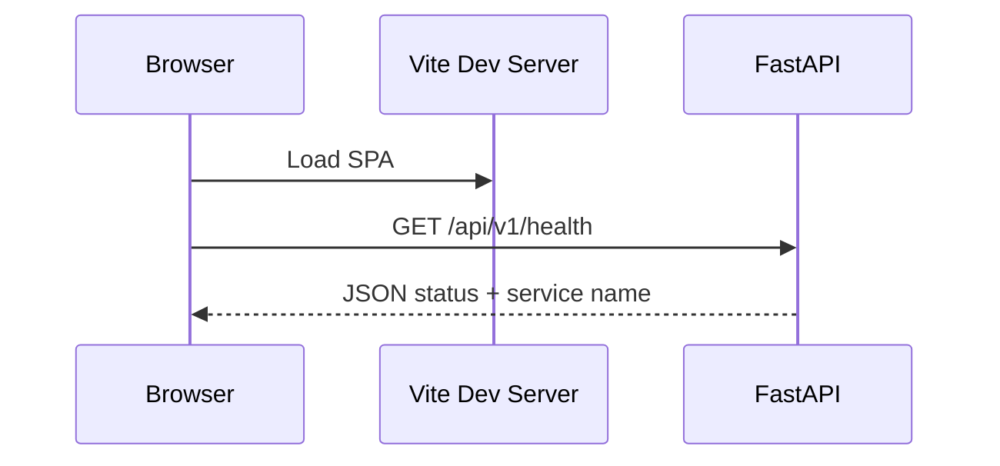

# CareFlow AI — Architecture (Phase 1)

## Overview

CareFlow AI is a monorepo with a React frontend and a FastAPI backend. Phase 1 focuses on project structure, local development, health endpoints, and frontend-backend connectivity—without patient databases, LangGraph agents, FHIR APIs, or ServiceNow integrations.

## Repository layout

| Path | Purpose |
|------|---------|
| `frontend/` | React + TypeScript + Vite + Tailwind CSS SPA |
| `backend/app/api/` | HTTP route definitions (versioned under `/api/v1`) |
| `backend/app/core/` | Configuration, logging |
| `backend/app/models/` | Pydantic schemas |
| `backend/app/services/` | Business logic (health/info today; workflows later) |
| `backend/tests/` | Pytest API tests |
| `data/synthetic/` | Future synthetic FHIR and demo datasets |
| `scripts/` | Local automation helpers |
| `docs/` | Architecture and roadmap documentation |

## Request flow (Phase 1)

The frontend reads `VITE_API_BASE_URL` and polls `/api/v1/health` to show connection status.

## Backend design

- **Configuration:** `pydantic-settings` loads environment variables (see root `.env.example`).
- **CORS:** Allows local Vite origins (`5173`).
- **OpenAPI:** Generated at `/docs` and `/api/v1/openapi.json`.
- **Separation:** Routes delegate to services; response shapes live in Pydantic models.

## Frontend design

- **Components:** Header, feature preview cards, demo notice, backend status badge.
- **Hooks:** `useBackendHealth` manages loading, success, and error states.
- **No fake actions:** Navigation uses in-page anchors only; feature cards are informational.

## Future extension points

- **LangGraph:** New packages under `backend/app/services/agents/` with orchestration entrypoints.
- **FHIR:** Synthetic resources in `data/synthetic/` and FHIR routers under `backend/app/api/v1/`.
- **PostgreSQL + pgvector:** Database module in `backend/app/core/` and repositories in `services/`.
- **ServiceNow:** Integration client in `services/` with human-approved workflow callbacks.

## Security and compliance posture

This project is a **local, synthetic-data portfolio demonstration**. It must not store or transmit real PHI and does not claim HIPAA compliance.
